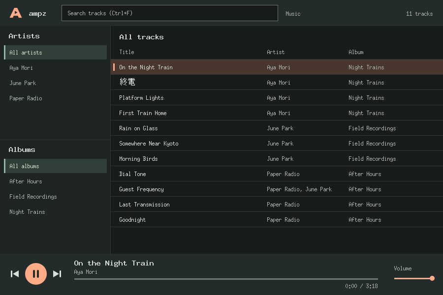

# ampz

[](https://github.com/agourlay/ampz/actions/workflows/ci.yml)
[](https://github.com/agourlay/ampz/releases)
[](#build-from-source)
[](LICENSE)


A small, native Linux MP3 player written in Zig. Point it at a music folder to browse by artist and album, select tracks, and play them in order.

## Download and play

Prebuilt Linux binaries run without installing Zig. You’ll need an X11 or XWayland desktop and either PulseAudio or PipeWire with PulseAudio support.

1. Run `uname -m` to find your architecture. From [GitHub Releases](https://github.com/agourlay/ampz/releases), download `ampz-x86_64-linux.tar.gz` for `x86_64` or `ampz-aarch64-linux.tar.gz` for `aarch64`. These archives will appear with the first release.
2. In the directory containing the download, extract the archive.

   ```sh
   tar -xzf "ampz-$(uname -m)-linux.tar.gz"
   ```

3. Open a terminal in the extracted folder and start the player with your music directory.

   ```sh
   ./ampz "$HOME/Music"
   ```

You can also save the folder and launch ampz without an argument.

```sh
./ampz --set-music-dir "$HOME/Music"
./ampz
```



ampz is an AI-generated project. ✨

## Build from source

With Zig 0.17.1, run this from the project directory.

```sh
zig build run -- "$HOME/Music"
```

To build the executable on its own, run `zig build`. You’ll find it at `zig-out/bin/ampz`. The MP3 decoder, library browser, and desktop protocol clients are implemented in Zig. The build uses only the Zig standard library and works offline.

## Configuration

ampz saves preferences in `$XDG_CONFIG_HOME/ampz/config.json`, falling back to `$HOME/.config/ampz/config.json` when `XDG_CONFIG_HOME` is unset, empty, or relative. The save command accepts a relative or absolute folder and records its absolute path. You can also edit the file directly. [Example config](config.json)

```json
{
  "music_folder": "/home/me/Music"
}
```

A folder argument overrides `AMPZ_MUSIC_DIR`, which overrides the saved preference. Both overrides apply only to that launch. A relative folder in the JSON file is resolved from the directory containing the file.

## Library and controls

ampz scans the folder and its subfolders on launch. It reads title, artist, album, disc, and track numbers from common ID3v1 and ID3v2 tags. For untagged music, an `Artist/Album/Title.mp3` folder layout supplies the display names. For tracks with multiple ID3v2.4 artist credits, each artist appears in the browser and can be found by search. Music files are opened read-only.

Titles, artist names, and album names use bundled Japanese glyphs and color emoji, including flags, skin tones, and joined sequences such as 👩🏽‍🎤. ASCII emoticons such as `:-)` display as written. ampz reads Unicode ID3v2 tags and UTF-8 filenames. The title bar shows the track name during playback and while paused. Window managers that display application icons show the Playhead logo beside it.

The top search bar filters tracks as you type, within the selected artist and album. Each word can match part of the title, artist, album, or relative file path, in any order. For example, `quartet live` can match an artist named “City Quartet” and an album named “Live Sessions”. ASCII letters match regardless of case.

| Action | Control |
| --- | --- |
| Focus the search bar | Click the field, press Ctrl+F, or press / |
| Paste into search | Ctrl+V |
| Leave search | Down or Tab to browse results, Enter to play a match, Escape to clear and leave |
| Filter the track list | Click an artist or album |
| Move through tracks | Up, Down, Page Up, Page Down |
| Play a selected track | Enter or double-click |
| Pause or resume | Space or the center transport button |
| Previous or next track | Transport arrows |
| Seek | Click the progress bar, or use Left and Right for five-second steps |
| Change volume | Click the volume slider |
| Scroll a pane | Mouse wheel over that pane |
| Quit | Q, Escape, or close the window |

Playback supports mono and stereo MPEG-1, MPEG-2, and MPEG-2.5 Layer III with indexed constant or variable bitrates. Free-format streams are unsupported. ampz holds the current compressed track and its frame index in memory, and decodes PCM as the sound server requests it.

## Tests

```sh
zig build test
```

The tests use short, generated tone recordings. They cover folder discovery, filtering, MPEG-2 intensity stereo, encoder-delay trimming on CRC-protected files, trailing artwork, and unsynchronised ID3 text. Reference PCM samples were measured with FFmpeg. The tests run without a display or audio device.

## Format references

The Huffman codebooks, scalefactor band boundaries, and synthesis window are numerical constants of the MPEG audio format. The decoder stores the codebooks as binary trees. The standardized values were cross-checked against the published encoder and synthesis tables. [MPEG audio specification](https://csclub.uwaterloo.ca/~pbarfuss/ISO11172-3.pdf) · [Huffman codes](https://github.com/lameproject/lame/blob/master/libmp3lame/tables.c) · [Scalefactor bands](https://github.com/lameproject/lame/blob/master/libmp3lame/quantize_pvt.c) · [Synthesis coefficients](https://github.com/FFmpeg/FFmpeg/blob/master/libavcodec/mpegaudiodsp_data.c)

## Credits

Thank you to the Quod Libet team for the artist-and-album browser that inspired ampz, and to the Zig contributors for the compiler and standard library. [Quod Libet](https://quodlibet.readthedocs.io/) · [Zig](https://ziglang.org/)

LAME helped us generate test recordings. FFmpeg gave us an independent decoder to check the output sample by sample. The minimp3 source helped us understand intensity stereo, and Mutagen helped us verify tagged files. [LAME](https://lame.sourceforge.io/) · [FFmpeg](https://ffmpeg.org/) · [minimp3](https://github.com/lieff/minimp3) · [Mutagen](https://mutagen.readthedocs.io/)

We also thank the X.Org, PulseAudio, and PipeWire contributors for the display and sound services ampz uses on Linux. [X.Org](https://www.x.org/) · [PulseAudio](https://www.freedesktop.org/wiki/Software/PulseAudio/) · [PipeWire](https://pipewire.org/)

The bundled glyphs come from Noto Sans CJK JP and Noto Color Emoji. The Unicode Consortium supplies the emoji sequence data. [Noto CJK](https://github.com/notofonts/noto-cjk) · [Noto Emoji](https://github.com/googlefonts/noto-emoji) · [Licenses](src/fonts/LICENSE.txt)

## License

The original ampz code is licensed under the [Apache License 2.0](LICENSE). The bundled fonts and Unicode data carry their own [third-party notices](src/fonts/LICENSE.txt).
